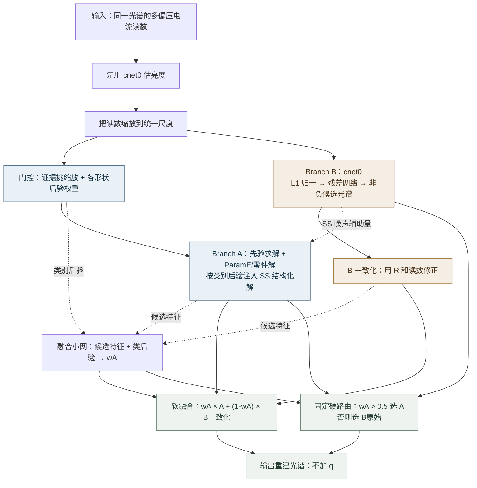
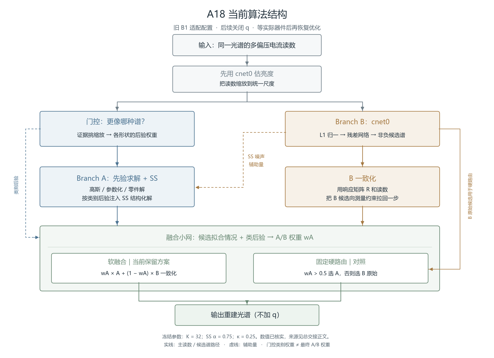

# A18 光谱重建总交接文档

# 一个月后从这里开始

**停在哪里：算法优化已暂停，等实际器件。**
最新分工材料是 22658；副导师已审：需轻微文字修改，数字已复现。新 B3 没有实现，不能把候选方案当成现成算法。
当前保留方案是完整 A、旧 cnet0 和软融合，后续不加 q。
**分工收益在 5% 上下，不稳；A 只在少数几族上确实有用。**
【推算：副导师对收益、族组成敏感性及路由对照的审查；详见第三节。】
【已核实：22658 报告与冻结配置；暂停与恢复条件来自老大指令。】

先按顺序读下面这些文件，暂不翻全部历史日志：

[22658 报告](diag/B1_新种子22658_20261104/report_22658.md)：最新分工、路由、q 消融和中断边界。

[22658 summary](diag/B1_新种子22658_20261104/summary.json)：快速核对指标、名单与配置。

[B1 HANDOFF](HANDOFF_A18-B1.md)：看末尾审查、预注册和未决事项。

[主驱动 a15_three.py](../算法对照/a15_three.py)：从 `build3`、`gate_of`、`decode_ac` 找入口。

[SS 与缩放 a16_ss.py](../算法对照/a16_ss.py)：核对冻结的字典、SS 和缩放设置。

**恢复第一步：先看已审的文字修订结论，再核对实测器件数据是否到位。**
没有数据就维持暂停。数据到位后，先收齐多偏压响应、暗帧和重复帧，建立实测 R 与噪声记录；不要先改网络。
再固定数据划分、比较方法、参数候选和停止条件，预注册后才跑。

**禁忌：6161、4242 禁用；31451 是 A 的 SS 调参集。**
81063、63862、22658 都已看过结果，不在这些评估种子上调参、早停或挑模型。
B3 最终种子和定版测试种子继续由副导师保管。
不覆盖旧结果，不把仿真写成 OPD 实测，不跳过预注册。
【已核实：本文件第六节引用的种子记录；保管安排及暂停指令由老大确认。】

---

截至 2026-11-04。按老大在本轮任务中转述的当日 16:27 要求整理。

**算法优化暂停。等实际器件出来、拿到实测响应和噪声后，再继续。**

本文件集中交代已有结果、纠正意见和未完成工作。
原 `交接文档.md`、README、各 HANDOFF、代码和结果均保留。
22658 是最新分工评估，**副导师已审：需轻微文字修改，数字已复现**。内部一致性核验不等于独立实现复核；本次独立数字复现另见副导师审稿来源。

## 阅读口径与证据等级

**已核实**：本轮读到了对应源码、配置或落盘输出。只证明本地材料有据，不表示器件实测成立。

**推算**：从仿真输出计算的均值、几何平均、比例、区间和分工判断。表前标签覆盖整张表。

**推测**：尚未验证的解释或未来方案。收益没有数值依据时不填数字。

**未找到**：在指定材料及补查范围内没有找到。不能据此断言从未存在。

暂停、B3 待办、保管种子和新老化调研的口头信息，来源是**本轮用户指令**。下文单独注明，不包装成历史文件已经核实的结果。

指定的 `D:/OneDrive/Terry/06_agent/_当前焦点.md` 未找到。
实际找到并读取的是 `D:/OneDrive/Terry/01_Research/_当前焦点.md`，其内容仍以较早的 A11 计划为主。
本文件按更新的诊断和本轮暂停指令交接。

# 整体思路

## 为什么留 A 和 B 两支

读数不能唯一决定光谱，只能结合经验推断。
B 像一个看过很多例子的熟练读者，直接猜出整条谱，通常更擅长宽峰、带通、边缘和一些 LED 谱。
A 会问：这组读数更像哪种形状？若像线、峰或台阶，就用对应的形状经验认真求解。

两支容易犯的错不完全相同，所以一起保留。
目的不是让 A 或 B 包打天下，而是在同一组读数上互相补位。
当前 A 的完整路径还包括高斯先验、峰参数化和零件解，SS 只是其中的结构化修正。
【已核实：主驱动、SS 源码及 22658 分支输出；“像熟练读者”只是解释用比喻。】

## 门控和融合分别在做什么

**门控先决定 A 该信哪类形状。**
例如读数既可能像窄线，也可能像窄线叠在背景上。
门控给这些解释不同权重，让 A 混合它们的解；它不提前知道真谱属于哪族。

**融合再决定 A 和 B 各听多少。**
它检查两支能否解释读数、相差多少、谱形是否异常，再给 A/B 权重。
软融合把两条谱按权重相加；硬路由只选其中一条。
“A 内部的类别权重”和“最后 A/B 的权重”是两层决定，不能当成同一个分类结果。
【已核实：`a15_three.py` 的 gate_of、decode_ac；B1 HANDOFF 第 4 节。】

## 现在怎么分工，为什么不用 q

最新分工以 22658 为准，完整名单见第四节。
它是后续开发的保护范围，不是部署时凭真实族名选分支的规则。
某些族的平均误差与配对统计结论不同，恢复时要连统计口径一起读。
【推算：22658 报告；副导师已审：需轻微文字修改，数字已复现。】

q 原本想在最后轻推峰位，但这一步会平移整条谱。
验证消融显示，整体形状误差没有因此变好，反而变差。
因此后续先拿掉 q，避免在已经重建好的光谱末尾再加一次没有收益的修正。
这是去留决定，不表示历史含 q 的代码和结果已被删除。
【已核实：22658/q_ablation/summary.json；误差方向为该输出的推算。】

## B3 打算改什么，先比较什么

候选是伪逆粗解加残差网络、波长轴上的一维 U-Net、平滑基输出头。
共同问题是：能不能让 B 更好地表达谱形，而不是只增加参数。
B 只训自己的族，还是同时学 A 的族，也要保留对照。
这些均为计划，收益尚属推测，没有新 B3 成绩。

老大提出的另一个对照是：**把 A 和 B 表现差不多、分工尚不清楚的几族，从分类任务里拿掉，看看能否减少误判、让 B 变好。**
这里“拿掉”先指不再强迫分类器区分它们，不等于把它们从最后评估里删除。
这些输入仍要重建，如何交给 B、是否设保底路径，恢复后事先写清。
具体哪些族拿掉，也应在开发数据上事先定，不能看最终评估再改名单。
【推测：待实施对照；问题与比较方向来自本轮老大要求。】

还要补分类混淆矩阵。
先看真实类别被判成了什么，再看误判是否真的伤害重建。
同时保留 A/B 选支的混淆统计，避免把“猜错谱族”和“选错分支”混在一起。
22658 已有逐族选支正确率；完整谱族混淆矩阵仍未测。
【已核实：现有报告的覆盖范围；补测为本轮要求，尚无结果。】

# 最新算法结构图

图示是当前交接配置：A 与旧 cnet0 配合，展示软融合和固定硬路由两种输出办法，均不加 q。
主驱动保留历史 q 流程，本轮没有修改算法代码。
门控与 A 的先验求解在实现中相互配合，图里按功能分开画。

图内 K=32、SS α=0.75、κ=0.25、硬路由阈值 0.5，均为【已核实：22658/model_freeze.json、a16_ss.py 与 report_22658.md】。
K 指难族先验簇数，不是 SS 原子数。
硬路由主图使用原始 B；用一致化 B 的辅助对照仍在第四节保留。
图中的连接来自现有代码，不表示门控和 SS 的收益已在实际 OPD 上验证。

# 一、研究什么，为什么需要重建

## 1.1 一个像素，测多次电流

目标是 OPD 计算光谱仪。OPD 指有机光电探测器。
只用一个探测像素，在不同偏压下读电流。
不同偏压改变探测器对各波长的响应，形成不同的光谱编码。
重建算法根据这组电流，反推出入射光在各波长的强度。

困难是：测到的电流数少，且不同偏压的读数高度相关。
很多不同光谱都可能给出接近的电流。
算法需要利用“光谱通常长什么样”的经验，选出合理的解。这些经验叫先验。

当前主算例有 **41 个偏压读数**，重建 **500–800 nm、间隔 4 nm 的 76 点光谱**。
这些网格数是计算设置，不能直接当成实测分辨率。
【已核实：`HANDOFF_A18-B1.md` 第 1 节；`diag/B1_新种子81063_20261104/summary.json` 的 architecture。】

## 1.2 当前用哪个响应矩阵

现在主要用 **Uddin 等，Nature Communications 15, 571 (2024)** 的公开实测响应矩阵。
DOI：`10.1038/s41467-024-44702-8`。
原始数据文件是 `SourceData_Uddin2024.xlsx`；整理后是 `R_uddin2024.npz`。
可见段原表是 **41 个偏压 × 31 个波长节点**，波长间隔 **10 nm**，再插值到重建网格。
【已核实：`交接文档.md` 第一节；`../算法对照/45_Uddin2024_真实R矩阵/scripts/forward.py` 的数据来源与 build。】

**Uddin 器件是 MoS₂/BP 无机二维隧穿二极管，不是 OPD。**
借用它，是因为公开数据足以搭建可复查的正向模型。
目前成绩证明的是算法在这套公开矩阵和仿真条件下的表现。
不能写成已经在自己的 OPD 上实现。
【已核实：`交接文档.md` 第一节。】

项目曾把器件结构和解码器一起设计。
后来的论文路线改为：简单器件结构、形状自适应解码、老化后的快速复标。
公开矩阵还包括 Cui、Wang；本文最新的分工和消融数字均来自 Uddin。
【已核实：`交接文档.md`“课题的大目标”。】

## 1.3 光谱、读数和噪声怎样生成

训练和评估主要使用合成光谱。
生成器覆盖单峰、多峰、带通、边缘、灯谱、干涉波纹、阶梯、组合谱等 **26 族**。
所有族都进入训练范围，不能再把其中一些叫“留出族”。
CIE LED 来自固定实谱库；新诊断用 `jitter=True` 做随机平移和斜坡增强。
它仍不等于全新的独立实测光源。
【已核实：`HANDOFF_A18-B1.md` 第 0 节；81063、22658 报告的数据边界。】

先用响应矩阵算光生电流，再加模拟误差。
扣除名义暗电流后的读数可以写成：

$$
\mathbf y=gR\mathbf s+(b-1)\mathbf I_{\rm dark}+\mathbf n.
$$

这里的离散光谱和响应运算已经包含相应网格、功率缩放。
整体增益或光源功率变化由 g 表示。
暗电流整体变化由 b 表示。
n 是逐偏压白噪声。

可见段设定为：暗电流倍数标准差 **1.5%**，增益对数标准差 **0.15**，白噪声标准差 **0.3 nA**。
这些幅度来自项目按作者测试读数建立的误差模型。
其中增益项混合了器件增益与光源功率差异，不能全解释成器件漂移。
【已核实：`../算法对照/45_Uddin2024_真实R矩阵/scripts/forward.py` 的 REAL 及注释。】

训练固定谱库有 **87,000 条**，主种子 **31337**。
每步重新抽功率和噪声。训练功率在 **0.5–2 P0** 之间按对数均匀分布。
新诊断的 real 模式固定参考功率 **P0=10.5423395868 µW**，每条谱抽 **4 次**带噪读数。
81063、63862、22658 均未额外启用 `--rerr` 响应矩阵扰动。
【已核实：`HANDOFF_A18-B1.md` 第 0、1 节；三个新种子报告。】

本文只报告带噪 real 模式性能。
`real` 是代码里的仿真模式名，不表示实测数据。

# 二、当前算法结构与冻结版本

## 2.1 先解决什么，再看两个分支

同一套解法很难同时照顾宽谱、窄线和复杂组合谱。
当前方法先分别给出两条候选光谱，再根据读数决定如何组合。

**Branch A** 用光谱形状先验求解。
**Branch B** 用训练好的网络直接预测谱形，代码名 `cnet0`。
日志还把 B 叫作 C、第三支、互补支·无加权。这些名字在当前配置下指同一支。

整体顺序是：

读数 → B 估亮度并统一尺度 → A、B 各出候选 → B 一致化 → 软融合。
历史版本最后再加 q；最新开发决定是后续 B3 不用 q。
【已核实：`../算法对照/a15_three.py` 的 build3、decode_ac；22658 的 q 决策。】

## 2.2 Branch A：先按读数判断形状，再求解

每种形状用训练谱建立均值和协方差。
收到电流后，算“这种形状能否解释这组读数”，并给各形状后验权重。
每个形状都能求一个条件后验均值，再按权重混合。
这一步叫贝叶斯门控，不是先拿到真实族名再选解。

固定噪声协方差时，单个高斯分量的解可简写为：

$$
\hat s_k=\mu_k+C_kR^{\mathsf T}
(RC_kR^{\mathsf T}+\Sigma_n)^{-1}(y-R\mu_k).
$$

实际实现还更新与信号有关的噪声估计。
峰参数化解 `ParamE`、零件网络解，也与高斯混合解一起进入 `fuse_parts`。
不能把完整 A 简化成“只做一次线性反演”。
【已核实：`交接文档.md` 第二节；`../算法对照/a15_three.py` 的 gate_of。】

为了更细地表示难族，部分单高斯先验改成多簇先验。
当前 **K=32** 是每个选中难族请求的高斯簇数。
它不是 SS 最多选 32 个形状，也不是 32 个谱族。
难族从验证集上的 B 误差排序选择，不能拿最新评估真值重新挑。
【已核实：`../算法对照/a15_three.py` 的 gf_a16a；22658/model_freeze.json。】

### 结构化求解 SS

窄线、峰和台阶等形状，单靠一个宽泛协方差不容易表达。
SS 从形状字典中逐步加入能改善读数解释的分量，再回扫和求后验均值。
是否加入，由贝叶斯证据增量决定。

SS 用在激光线、荧光灯、4–6 个峰、阶梯、零件组合对应路径。
按各族的后验权重注入 A，混合强度 **ss_alpha=0.75**。
多个字典类型分别求解，再按对应后验权重汇合，不是所有族共用同一条 SS 谱。
【已核实：`../算法对照/a16_ss.py` 的 USE、CFG、ALPHA、GateSS.apply。】

下表参数均为【已核实：同一源码的 CFG、KMAX；选择集声明在文件开头】。

| SS 类型 | 系数先验尺度 σa | 停止阈值 τ | 背景列数 | 最多形状组数 |
|---|---:|---:|---:|---:|
| lines | 1.0 | -1.0 | 3 | 6 |
| peaks | 0.3 | -1.0 | 0 | 7 |
| steps | 0.3 | 2.0 | 1 | 6 |
| general | 0.3 | 1.0 | 3 | 8 |

**这些 SS 参数在 31451 上选过。31451 是调参集。**
不能再把它包装成检验 SS 泛化的独立诊断集。

### 证据挑缩放 escale

B 对窄谱的亮度估计会偏，使 A 收到的尺度不合适。
A18 让 A 再比较不同缩放，选先验最能解释读数的那个。
当前在 **0.45–1.3** 之间取 **11 个**对数等分倍数。
比较边缘似然时加上换元项 n log c；算完后把 A 输出除回所选倍数。
融合验证读数也按 B 亮度缩放，保持与推理流程一致，称为 `vscale`。
【已核实：`../算法对照/a16_ss.py` 的 CG、escale；`../算法对照/a15_three.py` 的 a16a_vscale。】

这组缩放网格最初如何挑选，**未找到完整过程**。
不能写成已经证实“只在干净的非测试数据上定”。
【已核实：`HANDOFF_A18-R1.md` 对原交接、README 的纠正。】

## 2.3 Branch B：cnet0

B 先把电流按绝对值之和做 L1 归一，学习光谱形状。
推理后再用响应矩阵和读数拟合一个非负幅度。
所以网络本身不直接输入 R，但整个重建流程使用 R。

结构为 **41 → 512**，接 **4 个残差块**。
每块是 `LayerNorm → Linear → GELU → Linear`，块内宽度均为 **512**。
输出头是 `LayerNorm → GELU → Linear(512,76)`。
再用 Softplus 保证非负，按峰值归一。
可训练参数 **2,166,860 个**。
【已核实：`HANDOFF_A18-B1.md` 第 1 节；`../算法对照/a15_three.py` 的 CNet。】

训练使用谱形均方误差，加一阶差分误差。
导数项的准确比例 **r=44.404842417764215**，系数形式为 **0.5r**。
`cnet0` 去掉的是互补样本加权，仍保留导数项。
【已核实：`HANDOFF_A18-B2.md` 审查更正；`diag/B2_新种子63862_20261104/report_63862.md`。】

训练设定：AdamW，**30,000 步**，batch **2,048**，最大学习率 **1e-3**，weight decay **1e-4**，OneCycleLR，初始化种子 **11**。
旧 cnet0 没有单独验证早停，保存最后一步权重。
【已核实：`HANDOFF_A18-B1.md` 第 1 节。】

B 的一致化步骤利用验证误差协方差，把输出向读数约束拉回一步。
最新诊断适配配置的强度 **κ=0.25**。
一致化后不保证每族更好，所以必须分别报 `B_raw` 与 `B_consistent`。
【已核实：22658/model_freeze.json；81063、22658 的 summary.json。】

## 2.4 软融合、硬路由和分类准确率

**软融合**给两条谱连续权重：

$$
\hat s_{\rm soft}=w_A\hat s_A+(1-w_A)\hat s_{B,\rm consistent}.
$$

融合小网输入是 **8 个**残差、差异、粗糙度等特征，加 **24 维**合并后的对数后验。
结构是 **32 → 32（tanh）→ 2 logits → softmax**。
它在验证数据上训练，不知道评估谱真值。
【已核实：`HANDOFF_A18-B1.md` 第 4 节；源码 fit_blend3、decode_ac。】

**硬路由**用事先固定规则：**wA>0.5 选 A，否则选 B**，不加 q。
22658 同时报两版：选原始 B；选一致化 B。
它沿用软融合权重作决定，没有另训一个硬分类器。
【已核实：22658/report_22658.md“固定硬路由的准确率与条件误差”。】

下文的“分类正确率”只指选到了同一读数下误差更小的分支。
**A 内部具体谱族识别的逐族正确率和完整混淆矩阵：未测，未找到当前配置的结果。**
两者不能混叫。平均 A 权重也不是分类正确率。

## 2.5 q 修正是什么，为什么停用

融合谱的形状可能合适，但峰位仍偏。
q 小网只决定把整条融合谱向 A 的峰位平移多少，不重新改变 A/B 权重。
令 d 为 A 峰位减融合谱峰位，q 在 **0–1** 之间，平移量是 qd。
当峰位差绝对值超过 **12 nm** 时不修正，避免两支实际挑了不同峰。
网络有 **32 个**隐单元；冻结诊断 q 的 **λ=0.01**。
【已核实：`../算法对照/a11_peakfix.py` 的 DMAX、featx、fit_q、shift_np；22658/model_freeze.json。】

最新消融没有显示整体收益，反而使形状误差上升。
因此决定 **B3 不用 q**。这是开发决策，未改写历史含 q 的结果。
具体数字见第四节。

## 2.6 冻结的是哪一版

最新评估重建的是 **旧 B1 适配配置**。
它沿用现存 cnet0，在原训练、验证数据上重建 A、一致化和融合。
旧调参入口由 **60 条**改成验证集成员的 **40 条**，又共用噪声流，改变了后续验证读数。
固定 **σe=0.08、K=32、ss_alpha=0.75、κ=0.25**。
它不是正式 A18 历史测试运行的逐位复现。
【已核实：81063、22658 报告的“数据边界、冻结”段；strict_validation_adapter.json。】

22658 的完整状态清单覆盖 A 先验、SS 字典/配置、一致化协方差、R、融合和 q 的权重及归一化。
清单内部的完整状态指纹为：

`59f19648abb6ceab81cec07ca40d68c5ce188b38988d923738405e4c749976ce`

【已核实：`diag/B1_新种子22658_20261104/full_model_freeze.json` 的 sha256 字段；本轮回读。】

这是**状态条目的指纹**。该 JSON 文件本身的字节 SHA256 是另一值：

`f3a6b911eeef79a87a25c22ed8685103da4cac4a780cf75aa11b9dd40a09bd9d`

【已核实：本轮 Python 对该文件计算。】

以下均为 SHA256，【已核实：本轮计算文件哈希，并与 81063/source_manifest.json、22658/model_freeze.json 核对】。
算法路径相对 `06_重建算法`。

| 文件 | 文件内容 SHA256 |
|---|---|
| `算法对照/a15_three.py` | `2a102e3694d360fb5aa02f66ad95020cc7942f93de84b502a5874c69594b2a5d` |
| `算法对照/a16_ss.py` | `b8f6b5839a9e3b354f597119350b2a1eba2ae0f0a7e46a7fc64968f61912aeaf` |
| `算法对照/a11_peakfix.py` | `92b27853d8d1255b849c718d7bcc2ef1167959cc25e4a319dad2e14b1cd45a49` |
| `算法对照/a11_device.py` | `083502f4e6c99e824a386ed8ff1ff92d065085eedd3a0466e1f812440f5b56d4` |
| `算法对照/45_Uddin2024_真实R矩阵/scripts/forward.py` | `bda8fac260004ed8825824a8b1d062bf4eeebe7e3e6375d6e532bc01b01f54f2` |
| `算法对照/45_Uddin2024_真实R矩阵/results/a15_nets/cnet0.pt` | `aed7e14a36aa878207afe8e480e57a5b509bd01099e9512f4875b26f1edf6eb3` |
| `A18/diag/B1_诊断_20261104/q_validation_only.pt` | `ead0372278ce9f1a2c8edfd141a1e47efc1ee8d9115c4158de7d3f9ae27339ad` |

网络状态指纹与 `.pt` 文件内容哈希也要区分。
22658/model_freeze.json 登记的 B、融合、q 状态指纹分别为：

`B: 5ff59028c0cc77f64a0d2c9db23db641cf92a39f1e83deff45e2f7d473853ebc`

`fusion: e561fd7b5af1c21416b67a180f48fd5a3ab3c541ce666753e9e4f2f7418d3d84`

`q: e8f9e61498c6fe18b634919888a4b2d8747a88c35e169c335c032f91d81c70f3`

【已核实：上述 JSON。】

完整指纹清单不等于可直接加载的完整 checkpoint。
22658 报告说明 A/融合需确定性重建；**未找到该轮可直接加载的完整 A18 推理 checkpoint**。
81063 当时没有完整 A 指纹，不能追溯证明两轮完整 A 逐字节相同。
两轮已核对网络状态及验证输出。
【已核实：22658/report_22658.md。】

# 三、目前保留的通用方案及数字

目前保留的交接基线是：**A18 的旧 B1 适配配置，完整 A + 现存 cnet0 + 一致化 + 软融合，不加 q**。
**分工收益在 5% 上下，不稳；A 只在少数几族上确实有用。**
【推算：副导师对 22658 的审查；数字必须连同族组成和比较对象阅读。】
未找到新 B、实际 OPD 或最终盲测已经胜出的版本。
B2 的知族 oracle 是诊断工具，不能拿它替代通用解码器排名。

计分时，重建谱和真谱各自除以波段内峰值。
在目标波段计算两者的 RMSE，再除以归一真谱的极差，得到形状 NRMSE。
每族先对光谱和重复读数取算术平均，再对各族均值取几何平均。
它与后文逐谱配对 log 比的计分对象不同，不能互换。
【已核实：22658/report_22658.md 的误差定义；B1 HANDOFF 对 ladder.band_nrmse 的说明。】

以下为【推算：22658/summary.json、family_metrics.csv；本轮从逐族 CSV 重新计算几何平均，与 summary 一致】。
该轮 **每族 150 谱、每谱 4 读数**，共 **3,900 谱、15,600 读数**。
全部带噪仿真，**副导师已审：需轻微文字修改，数字已复现**。

| 方法 | 26 族几何平均 NRMSE |
|---|---:|
| B 原始 | 0.068882 |
| B 一致化 | 0.069630 |
| A | 0.082270 |
| 软融合，不加 q | **0.063773** |
| 软融合，加 q | 0.064134 |
| 硬路由 A/原始 B，不加 q | 0.064483 |
| 硬路由 A/一致化 B，不加 q | 0.065017 |

相对原始 B，软融合不加 q 的误差变化是 **−7.42%**；硬路由 A/原始 B 是 **−6.39%**。
两者不是同一方法，不能互换数字。
对应误差降低的描述性 **95%** 区间分别是 **[6.80%, 8.04%]**、**[5.75%, 7.04%]**。
【推算：22658/aggregate_uncertainty.json；副导师已独立复现。】
Codex 审稿对五个整体对照作 Bonferroni 校正后，原始 B 硬路由降幅的下界仍为 **5.55%**。
【推算：副导师 Codex 输出；五项整体比较与逐族比较是不同校正范围。】

收益对族组成敏感。去掉卤素灯一族，软融合和原始 B 硬路由的降幅分别只剩 **5.17%**、**4.06%**。
区间只覆盖固定族集合内的谱抽样波动，没有计入族组成的不确定性。
【推算：云端 22658 审稿报告；原区间是事后描述性补充，不保证换族后仍越线。】

硬路由改用一致化 B，若仍以原始 B 为参照，降幅为 **5.61%**，**95%** 区间下界 **4.95%**，低于 **5%**。
这与“相对一致化 B”的比较不同。比较对象是旧 cnet0，新 B 还没训，不能说过了停止线。
【推算：云端审稿报告；原始 B 硬路由未校正下界 5.75%、软融合下界 6.80% 见上。】

这不是“新 B 已满足停止线”。新 B 尚未实现。
登记的停止线是：相对**新 B**，融合至少改善 **5%**，且至少 **5 族** A 经校正稳赢。
未来仍须在独立评估和实际器件条件下判断。
【已核实：`HANDOFF_A18-B1.md` 的老大决定及预注册；阈值是事前要求。】

速度已有单条实测计时，但测的是旧含 q 流程。
单条总耗时中位 **225.5 ms**，p90 **245.2 ms**；batch **256** 平摊 **87.5 ms/条**。
环境为 RTX 5070 Ti，计时含桌面 GPU 程序影响。
不能直接当成不加 q 的新配置延迟，也不能把旧批量平摊数字当单条延迟。
【已核实：`results/latency_R1/latency.json`；`HANDOFF_A18-R1.md` 末尾计时更新。】

# 四、各轮结果、最新分工和 q 消融

## 4.1 从 A11 到 A18：留下什么

A11 建立门控、网络、一致化和逐谱融合。
A12 增加峰位 q 修正。
A15 引入新的残差网络；后续消融显示，主要提升来自新网络本身。
A16 去掉旧网络，保留 A 与 cnet0 两支。
A16A 给难族增加多簇先验，并把簇后验合回族级供融合使用。
A17 加 SS，同时修复融合验证与推理的尺度不一致。
A18 再加证据挑缩放。
【已核实：`交接文档.md` 第三节；其中早期贡献判断有些仅转引旧会话，不升级为新独立证据。】

旧开发口径记录的几何平均：A16 **0.0682**、A16A **0.0659**、A17 **0.0647**、A18 **0.0628**。
【已核实：`README.md`、`交接文档.md` 的历史 6161 汇总。】
这些数只交代发展过程。6161 已反复用于取舍，不能作干净最终测试。
本轮不重跑，也不据此继续优化。

## 4.2 B1-81063：小样本重评

模型先重建、冻结，后生成 **81063**。
每族 **30 谱 × 4 读数**，共 **780 谱、3,120 读数**，噪声种子 **4321**。
【已核实：81063/report_81063.md、summary.json。】

下表为【推算：同目录 summary.json、family_metrics.csv；本轮重算核对】。

| B 原始 | B 一致化 | A | 软融合 q 前 | 软融合 q 后 |
|---:|---:|---:|---:|---:|
| 0.066073 | 0.067010 | 0.082901 | 0.062370 | 0.062755 |

当轮百分位 bootstrap、逐谱配对 log 比、族间 Bonferroni 校正，并要求点估计至少改善 **5%**。
按此原判据，A 对原始 B 稳赢 **4 族**：宽谱带吸收凹陷、卤素灯、荧光灯式多线、干涉波纹。
B 稳赢 **11 族**，另 **11 族**未定。
【推算：81063/summary.json 的 statistics；具体完整名称以该文件为准。】

随后采用百分位与 t 区间的保守外包络，离线重算旧 CSV。
同口径 A 只剩 **3 族**：宽谱带吸收凹陷、卤素灯、干涉波纹；B 仍为 **11 族**。
不能把这组数与当初的四族混用。
【推算：22658/comparison_81063_same_rule.json；22658 报告的旧 CSV 对照。】

q 后融合比旧 B 原始低 **5.02%**，但审查给出的 **95%** 区间约 **[3.66%, 6.4%]**。
正确措辞是：**点估计达标，与 5% 停止线分不开**。
它又是软融合、旧 B、适配配置，不能代替新 B 硬路由的停止线。
【推算：`HANDOFF_A18-B1.md`“11:32 副导师审查”。】

该轮数值写完后，目录外变化断言退出，原退出码没有改写。
后续核验记录为 PASS；异常和范围复核保留。
【已核实：81063/report_81063.md、verification.json、scope_review.json。】

## 4.3 B2-63862：先验空间还是网络能力

B2 针对阶梯、零件组合、随机光滑、同分布五类，另放宽单峰和宽带通作对照。
比较旧 B、A、两种专用网络和先验估计器。
知族 oracle 在推理时知道顶层真族；不知族版本只混合本轮候选族。
它们都不是严格信息论误差下界。

**63862 只做冻结评估，不重训、不重拟、不挑 K。**
生成了全部 **26 族、780 条谱**以保持噪声推进顺序，只评估 **6 族、180 谱、720 读数**。
噪声仍为 **4321**。
剩下的族已经生成和查重，不能以后冒充全新盲集。
【已核实：63862/report_63862.md、summary.json；`HANDOFF_A18-B2.md`“12:12 副导师审查”。】

下面两表的 NRMSE 为【已核实的仿真汇总输出：63862/family_metrics.csv、summary.json；解释和优势判断属于推算】。

| 谱族 | B | A | 专用 512×4 | 专用 768×6 |
|---|---:|---:|---:|---:|
| 阶梯谱 | 0.229595 | 0.219383 | 0.202274 | 0.203977 |
| 零件组合 | 0.164021 | 0.184488 | 0.174731 | 0.175582 |
| 随机光滑 | 0.086286 | 0.089091 | 0.075836 | 0.090469 |
| 同分布五类 | 0.091015 | 0.100632 | 0.077215 | 0.078215 |
| 单峰 60–200 nm | 0.035350 | 0.065951 | 0.040881 | 0.039176 |
| 宽带通 | 0.060277 | 0.141667 | 0.195818 | 0.204356 |

| 谱族 | 知族 K64 | 知族 K256 | 不知族 K64 | 不知族 K256 | 旧 selected |
|---|---:|---:|---:|---:|---:|
| 阶梯谱 | 0.183345 | 0.184900 | 0.188671 | 0.186936 | 0.183345 |
| 零件组合 | 0.163393 | 0.158646 | 0.165555 | 0.162219 | 0.163393 |
| 随机光滑 | 0.066152 | 0.076919 | 0.069308 | 0.078520 | 0.066152 |
| 同分布五类 | 0.091267 | 0.072965 | 0.088794 | 0.083217 | 0.066029 |
| 单峰 60–200 nm | 0.009818 | 0.008239 | 0.017698 | 0.016008 | 0.008790 |
| 宽带通 | 0.050693 | 0.046256 | 0.050271 | 0.046206 | 0.045843 |

K64/K256 是请求总分量数。小簇会被剔除。
同分布五类 K256 实际有 **253 个**；其旧 selected 是另一套保留训练子类结构的 **320 分量**配置。
前三个目标族的 selected 就是 K64，不能重复算成独立支持。
【已核实：63862/frozen_prior_manifest.csv；`HANDOFF_A18-B2.md` 审查记录。】

**结论采用较新的审查口径。**
原预注册按每项方法分别校正四个目标族。
副导师另把 **32 项**比较统一校正，结果更保守：

阶梯：两种 specialist、selected、知族 K64/K256、不知族 K64/K256，共 **7 项**仍保留稳定改善，较大 specialist 接近边界。

零件组合：没有稳定改善项。只能说本次尚未取得可靠提升，不能说信息已经不够。

随机光滑：只剩知族 K64。selected 与它是同一配置，不另算独立方法。

同分布五类：降为未定。

【推算：`HANDOFF_A18-B2.md`“12:12 副导师审查”；统计表仍保留原预注册四族口径。未找到把统一校正全部写回原 report 的最终修订记录。】

专用网络没有训练两个对照族，其退化说明专用化代价。
不能用来断言这类网络普遍更差。
知族估计器在强对照族也更好，收益不能全归为“第六类网络容量不足”。

本地审查把知族 oracle 也改用估计噪声后，比值变化不超过 **0.0003**。
因此这轮知族/不知族差异几乎都来自候选族混合先验。
原报告“二者差异不能拆”的文字应按审查修改。
【推算：同一 12:12 审查记录。未在本轮另跑该反事实计算。】

63862 的结论不参与 B1/B3 方案选择，是已登记的数据边界。
【已核实：63862/execution_protocol.json；`HANDOFF_A18-B2.md` 的重评预注册。】

## 4.4 22658：最新分工，副导师已审：需轻微文字修改，数字已复现

**审稿结论：副导师已审：需轻微文字修改，数字已复现。只改文字，无需重跑。**

来源：[云端审稿报告](https://github.com/terry002531/research/blob/review/a18-b1-22658/opd-a18/reviews/B1_22658_claude_cloud.md)。
仓库 terry002531/research，分支 review/a18-b1-22658，路径 opd-a18/reviews/B1_22658_claude_cloud.md。
Codex 本地输出：C:/Users/Shi/cc_cloud/b1_22658_codex_utf8.txt。
本轮已读取两份来源，只修交接文字，没有重跑算法或评估。

**A 保护集限定在旧 cnet0 及其辅助量下。新 B 出来后必须重定。**
A 的缩放、SS 辅助量和难族先验分配与旧 B 有关，不能直接移植名单。

每族 **150 谱、4 次 real 读数**；噪声种子 **1022658**。
副导师核实：22658 **只生成一次、只评估一次**。
中断后复用保存谱和已完成输出；前两族测量流的确定性重放不算另做一批评估。
【已核实：22658/report_22658.md、generation_provenance.json、continuation_generation_calls.json。】

判据先对每谱的重复读数计算平均 log(A/B)，再按谱配对统计。
百分位 bootstrap 与 Student t 都报，均做 **26 族 Bonferroni**，取区间外包络。
A 稳赢须保守上界小于零，且配对几何比 **A/B≤0.95**；B 用对称规则。
bootstrap 为 **200,000 次**，种子 **1901122**。
【已核实：22658/summary.json 的统计配置；下列族数和名单为推算。】

### 在旧 cnet0 下，A 稳赢 8 族

4–6 个峰。

宽谱带吸收凹陷。

卤素灯 2000–3500 K。

荧光灯式多线。

干涉波纹。

阶梯谱。

LED+卤素。

激光线+宽背景。

### B 稳赢 11 族

单峰 15–60 nm。

单峰 60–200 nm。

近邻双峰。

洛伦兹峰。

不对称峰。

窄带通。

宽带通。

锐边缘 2–10 nm。

CIE LED 实谱。

RGB 三色 LED。

斜坡+单峰。

### 7 族未定

同分布五类。

窄线 4–10 nm。

白光 LED 合成。

随机光滑。

零件组合。

双带通。

透射谱。

【以上族数、名单均为推算：22658/summary.json 的 statistics；本轮与 family_metrics.csv 核对一致。比较对象是旧 cnet0 原始 B。】
副导师把逐族 Bonferroni 的比较数扩大到 **52 项或 78 项**，**8/11/7** 名单均不变。
【推算：云端审稿独立复算；不把原预注册的 26 项事后改写成另一协议。】

“稳赢”限定于上述配对 log 比统计量。
例如激光线+宽背景，A/B 配对几何比 **0.8408**，但族内算术平均 A 为 **0.25029**，原始 B 为 **0.22916**，A 反而高 **9.22%**。
【推算：22658/report_22658.md“统计量差异必须单列”。】
窄线 **4–10 nm** 也有方向反转：算术均值 A 为 **0.04508**，B 为 **0.04689**，看起来 A 较好；配对几何比 **1.116** 却倾向 B，分类仍为未定。
【推算：云端审稿及原逐族表；几何比不是多数样本比例。】

因此旧 cnet0 下的保护集不能直接变成“知道真实族名就整族选 A”。
未定也不能解释成两支等效。

### 各族重建误差与门控选支正确率

下面全部为【推算：22658/family_metrics.csv、report_22658.md】。
软融合不加 q，使用 B 一致化；硬路由选 A/原始 B，不加 q。
正确率以“该次读数是否选到误差更小的分支”为准，平局归 B。
每族 **600 次读数**来自 **150 条谱**，不能当作 600 条独立谱。
这张表不是 A 内部的谱族混淆矩阵。

| 谱族 | B 原始 | A | 软融合 | 硬路由 | 选支正确率 |
|---|---:|---:|---:|---:|---:|
| 同分布五类 | 0.09503 | 0.08721 | 0.07662 | 0.08088 | 66.2% |
| 窄线 4–10 nm | 0.04689 | 0.04508 | 0.03773 | 0.03885 | 65.5% |
| 单峰 15–60 nm | 0.02381 | 0.03998 | 0.02440 | 0.02371 | 75.2% |
| 单峰 60–200 nm | 0.03475 | 0.06151 | 0.03565 | 0.03502 | 76.0% |
| 近邻双峰 | 0.03604 | 0.07611 | 0.03757 | 0.03792 | 86.0% |
| 4–6 个峰 | 0.14539 | 0.13292 | 0.13059 | 0.13835 | 50.8% |
| 洛伦兹峰 | 0.06055 | 0.08064 | 0.05865 | 0.06163 | 72.0% |
| 不对称峰 | 0.04587 | 0.07916 | 0.04521 | 0.04594 | 76.8% |
| 窄带通 | 0.04042 | 0.08073 | 0.04165 | 0.04045 | 96.7% |
| 宽带通 | 0.05974 | 0.15306 | 0.06184 | 0.05974 | 99.5% |
| 锐边缘 2–10 nm | 0.05242 | 0.09889 | 0.05340 | 0.05266 | 89.0% |
| 宽谱带吸收凹陷 | 0.14180 | 0.12456 | 0.12792 | 0.13278 | 58.0% |
| 卤素灯 2000–3500 K | 0.03881 | 0.02001 | 0.01975 | 0.01968 | 84.0% |
| 白光 LED 合成 | 0.01781 | 0.01925 | 0.01842 | 0.01790 | 53.0% |
| CIE LED 实谱 | 0.03624 | 0.05949 | 0.03783 | 0.03635 | 85.0% |
| 荧光灯式多线 | 0.21173 | 0.16815 | 0.16686 | 0.17147 | 71.8% |
| 干涉波纹 | 0.16342 | 0.12799 | 0.12782 | 0.12782 | 71.2% |
| 阶梯谱 | 0.22849 | 0.21031 | 0.21459 | 0.22549 | 46.8% |
| 随机光滑 | 0.07948 | 0.08262 | 0.07237 | 0.07821 | 59.7% |
| 零件组合 | 0.16907 | 0.18570 | 0.16905 | 0.17090 | 54.7% |
| 双带通 | 0.10284 | 0.10523 | 0.09874 | 0.10247 | 56.0% |
| LED+卤素 | 0.06176 | 0.05954 | 0.05749 | 0.05760 | 59.8% |
| 激光线+宽背景 | 0.22916 | 0.25029 | 0.21460 | 0.21017 | 72.0% |
| RGB 三色 LED | 0.03089 | 0.03289 | 0.03073 | 0.03085 | 58.0% |
| 斜坡+单峰 | 0.09053 | 0.13883 | 0.09232 | 0.09252 | 83.8% |
| 透射谱 | 0.05919 | 0.05779 | 0.05437 | 0.05666 | 58.5% |

正确选 A 时的条件误差、正确选 A 的样本数，以及对一致化 B 的准确率，也已保存在同一 CSV 和报告。
它们使用真值筛子集，只能诊断，不能当可预知的部署性能。

### 审稿补充：门控、近重复与旧种子对照

总体选支准确率 **70.2%**，一律选 B 的基线为 **59.5%**。
A 稳赢的 **8 族**中，有 **5 族**低于“按族固定选多数支”的准确率基线。
【推算：云端审稿；多数基线知道真族名，只作诊断。】
即使按真族名分工，把这八族交 A、其余交 B，整体也只降 **5.20%**。
该数在选名单的同一数据上算，仍可能偏乐观，不能当部署路由。
【推算：同一审稿报告。】

副导师用峰值归一后的逐谱最近邻 RMS 距离 **<10⁻³** 补查近重复。
22658 内部有 **105 条**，与 81063 之间有 **34 条**。
跨种子的 34 条全在卤素灯族；内部 105 条按审稿原文分布在卤素灯、CIE LED 实谱、单峰 60–200 nm、同分布五类、白光 LED 合成五族。
【推算：云端报告“另查项”。本轮用户摘要将两组都归于卤素灯，与原文有出入；此处按原文登记，族归属差异待确认。】
这些低维族的有效独立样本少于名义的 **150 条**，区间可能偏窄。
【推测：审稿解释；完全重复为零不等于近重复独立。】

与 81063 对照，副导师认为新增保护族主要来自每族样本由 **30** 增至 **150** 后区间变窄、统计功效提高；旧点估计已经相近。
【推算：云端审稿。】
两批谱池和噪声流也不同，不能当纯样本量因果效应，更不是新算法收益。

### 内部一致性核验与中断边界

verification.json 记录 passed，计数为 **2,971 项内部一致性核验**。
其中 **1,200 项**是检查点和由它拼出的最终 CSV 逐行比对，属于自证；约 **744 项**复用了生产代码里的统计函数。
这不是独立实现的核验次数。另有文件哈希等检查；未逐项列出的部分不统称独立验证。
【已核实：云端与 Codex 对核验实现的审计。】
副导师另外从逐读数数据独立复现数字，应与上述内部计数分开说。
完整冻结状态在评估前后匹配，是原内部记录及过程审计支持的结论。

过程中有两类执行脚本错误：工作缓存进入完整指纹导致断言；进度文件更新被过宽防覆盖规则拦截。
原日志、脚本和退出错误保留。
缓存探针支持的是从同一冻结状态两次解码结果相同；源码中的 _m2 在单次调用内先写后读。
完整状态比较前恢复了工作缓存，再读取保存谱续算；不能扩大成对所有缓存操作的独立证明。
不能把这些错误说成算法失败，也不能抹掉失败记录声称一遍顺利完成。
【已核实：22658/report_22658.md、缓存审计文件；探针边界按云端审稿修订。】

另一次 Report content digest 报错由 **CRLF** 换行引起，改成 **LF** 后与原登记指纹一致。
数字、阈值和判据都没改，也没有改登记哈希去迁就结果。
【已核实：云端与 Codex 对原报告、备份、日志及登记值的核对。】

另有 `HANDOFF_A18-B3.md`，实际记的是较早 **31600** 诊断的异常交接。
它不是本节 22658，也不是已经训练好的新 B3 网络。
那轮结束保护断言未通过，不能标作完整成功交付。
【已核实：该 HANDOFF 的标题、种子与核验状态。】

## 4.5 q 消融：停用依据来自验证集

q 去留在生成 22658 之前决定。
只用验证谱 **31438**，每族 **40 谱 × 4 次**带噪读数，噪声种子 **9090**。
加载冻结 q，不重训、不重选 λ。
这批谱参与过 q 和融合拟合，是开发比较，不是独立泛化证据。
【已核实：22658/q_ablation/summary.json、q_decision_before_evaluation.json。】

下列数字为【推算：同目录 q_ablation/summary.json、report_22658.md】。

q 前跨族几何平均 **0.062059**，q 后 **0.062370**。
逐谱配对几何比为 **1.006469**。
保守 **95% log 比区间 [0.004453, 0.008458]**，整体方向是变差。
没有任何族的算术平均误差变差超过事前阈值 **10%**。
但“整体区间显示改善”这一保留条件没有满足，因此 **B3 不用 q**。

22658 的含 q 列只作完整诊断，不参与去留选择。
该轮 q 后相对 q 前误差约增加 **0.57%**。
【推算：22658/aggregate_uncertainty.json；不能混用验证集的配对几何比。】

# 五、已经纠正的说法

## 5.1 “加大网络更差”说过头

较大 specialist 只在一个初始化、固定谱库和特定专用训练预算下测过。
旧四族均值差区间 **[−0.00307, +0.00827]** 跨零；只有随机光滑出现明确变差。
大网络的每谱重复曝光更多，容量、训练分配和过拟合混在一起。
只能陈述本次对照结果，不能推出“大网络普遍更差”或“容量路线已被否定”。
【推算：`HANDOFF_A18-B2.md`“10:50 副导师审查”第 4 条。】

## 5.2 “零件组合信息不足”已收回

旧 oracle 停在有限 K，未证明饱和。
增加分量仍会改变结果；知族先验本身也不是严格下界。
现阶段只能说：本轮尝试未取得稳定提升，原因尚未分清。
不能说它已经到信息极限，或者换什么网络都没用。
【已核实：`HANDOFF_A18-B2.md` 的两轮审查；63862 报告的旧结论修订。】

## 5.3 “81063 上融合越过 5%”缺少把握

当时只是旧 B 软融合的点估计接近阈值，区间跨过停止线。
一致化 B 与原始 B 的比较对象也不同。
不能据此宣布新 B 的停止线通过。
【推算：`HANDOFF_A18-B1.md`“11:32 副导师审查”；详见第四节。】

## 5.4 31451 不是干净诊断集

它是 A 的 SS 调参集。换一份噪声仍是同一批真谱。
旧 A 分工数字可能偏乐观，后续应看新谱池评估。
同时，新旧种子变化混合了谱池和噪声变化，不能把差幅全叫“去泄漏代价”。
【已核实：`../算法对照/a16_ss.py` 开头；B1、B2 审查记录。】

## 5.5 适配配置、统计量、缓存与计时不能混写

复现旧 B1 的验证结果，不等于逐位恢复正式 A18。
簇后验不是最终 A/B 权重；平均权重不是分类准确率。
配对 log 比不是族内算术均值之比。
“知道真值时选最好”是诊断参照，不是可部署算法。
冻结状态匹配包含工作缓存的记录与恢复，不表示推理时缓存从未变化；缓存探针只支持从同一冻结状态两次解码一致。
旧批量平摊时间不能冒充单条延迟。
【已核实：81063、22658 报告；`HANDOFF_A18-R1.md`。】

## 5.6 其他旧表述

原“难族 A 从 **0.199 到 0.162**”只有代码注释，未找到对应运行日志。
保留为低强度历史线索，不作为新结果。
【推算：`交接文档.md` 第三节及 R1 纠正。】

原“缩放网格完全在非测试集上选定”无法核实。
固定 CIE 实谱在旧 `jitter=False` 流程存在跨集合重复，不能只看种子名不同就说独立。
【已核实：README、R1 及旧交接的更正。】

# 六、种子登记与数据边界

下表用途为【已核实：B1/B2 HANDOFF、三个新种子报告及其 provenance/config；最后两项保管状态据本轮用户指令】。

| 种子或集合 | 用途与当前边界 |
|---|---|
| 31337 | 主训练谱库；派生流也属于训练来源 |
| 31438 | 融合、κ、q 等开发验证；22658 还用于旧配置重建和两次缓存探针；不进入主评估统计，不当最终盲评 |
| 31451＝31438+13 | A 的 SS 调参集；不能作 SS 独立泛化证据 |
| 81063 | 已用 B1 诊断，每族 30 谱；已见结果，不能转作新 B 调参验证 |
| 63862 | 已用 B2 诊断；全部 26 族已经生成，只有 6 族进入本轮主评估；不参与 B1/B3 选择 |
| 22658 | 已用最新分工诊断，每族 150 谱；副导师已审：需轻微文字修改，数字已复现；已见结果，不再是未来盲评集 |
| 6161、4242 | 历史测试/开发种子，当前禁用；不生成、不重跑、不用于新取舍 |
| B3 最终评估种子 | 由副导师保管，未使用；具体值未找到，不自行猜取 |
| 定版测试种子 | 由副导师保管，未使用；具体值未找到，不自行猜取 |

已用的辅助诊断流也不能遗漏。
R1 记录过 **31445＝VSEED+7**、**31459＝VSEED+21**；B3 异常交接还用过 **31600**。
【已核实：`HANDOFF_A18-R1.md` 的诊断参数表；`HANDOFF_A18-B3.md`。】

读数噪声种子与光谱种子分开登记。
81063、63862 用 **4321**；22658 用 **1022658**；q 消融用 **9090**。
训练初始化 **11** 不是评估种子。原高斯先验拟合也用过历史 seed **11**，不可误删出允许训练来源。
【已核实：各报告及 B2 补白名单审查。】

判断独立性要看生成器实际调用和派生流，不能只比主种子名字。
现有新评估按小数点后 **9 位**逐谱比对允许的训练、验证和旧 SS 调参数据，未发现完全重复。
副导师后续补查的近重复见 4.4 节；原 overlap.json 仍只支持完全重复为零。
31438 两次缓存探针发生在生成 22658 前，没有调参；但用途不符合“只用于 q 消融”的更窄字面限制，必须登记实际用途，不事后改写预注册。
【已核实：副导师 Codex 过程审计。】
尚未完成与所有旧禁用测试谱的逐条查重。
【已核实：81063、22658 的 overlap.json 和报告边界。】

# 七、局限：实际器件可能更差

**全部算法成绩都是仿真。** 响应矩阵源于公开实测，但输入电流主要由模拟器生成。
尚无自己的 OPD 闭环重建与老化验证。

噪声是简化模型。
已有白噪声、整体增益和暗电流漂移，但没有完整覆盖低频相关噪声、迟滞、偏压扫描历史、温漂和非平稳误差。
不能把 real 模式理解成现实误差已经完整还原。

没有显式工艺偏差和制备失配。
每个器件单独标定可以处理部分器件间差异；真正还需检查的是标定到测量期间的变化，以及标定时器件能否保持稳定。

响应矩阵固定。生成读数与解码共用同一名义 R。
虽然噪声模型含整体增益变化，但没有模拟老化造成的波长、偏压相关响应形状漂移。

训练和测试谱族偏干净。
两边共用合成机制，CIE 增强也依赖固定谱库。
复杂真实光源、跨族混合、仪器杂散光和分布失配还没有充分验证。

形状误差会先去掉绝对幅度。
形状好不等于绝对功率准；计算网格细也不等于实测分辨率高。

bootstrap 区间只反映既定生成器和噪声模型里的谱抽样波动。
它不包含换器件、换 R、老化、标定误差模型错误带来的不确定性。
实际器件可能更差，差多少尚不能给数字。

【以上局限已核实于 B1/B2 HANDOFF 与三个报告；“实际可能更差”是有这些缺项支持的推测，不是已测退化量。】

# 八、暂停状态、未完成事项与下一步

## 8.1 当前先停在这里

按本轮老大指令，暂停算法优化。
不继续训 B，不开新架构搜索，不重跑旧测试，不拿诊断集反复挑参数。
等实际器件及标定数据出来，再决定是否恢复以下计划。

22658 副导师审查已完成：需轻微文字修改，数字已复现，无需重跑。
保护集只对旧 cnet0 成立，新 B 出来后重定，不能据旧 B 收益宣布新 B 停止线通过。

## 8.2 B3 候选结构：仅计划

本轮指令明确保留以下候选：

**伪逆粗解 + 残差网络**：先给出由 R 和读数得到的粗谱，再让网络学习修正。

**1D U-Net**：在波长轴上处理多尺度形状。

**平滑基输出头**：先输出平滑基系数，再合成光谱，检查是否减少不必要振荡。

这些方案尚未作为新 B3 实现和验证。
未找到包含上述完整三项的独立 B3 结构调研定稿、可加载模型或成绩。
本节来源为**本轮用户指令**；可能收益均属推测，不填数值。

旧 B1 HANDOFF 另有多尺度头、读数约束、刷新训练谱池和训练采样的方案。
它们仍是未实施方案，部分“按 A 可靠性加权”与以前 bwA 失败先例相近，不能直接换名重做后声称新意。
【已核实：`HANDOFF_A18-B1.md` 第 5 节及审查。】

## 8.3 B 的训练范围尚未定

要比较“B 只训自己的族”和“B 仍兼训 A 的族”。
不能默认去掉 A 族就一定更好。专用化可能损伤跨族表达，也可能提高目标族训练效率。
这是待验证假设。

老大另提：**把分不开的族从分类里拿掉，看看能否减少误判、提升 B。**
要保留这个对照。将来先写清哪些类别退出、输入如何处理、边界样本如何交给 B，再按固定规则比较。
没有证据表明它已经执行或有提升。
【来源：本轮用户指令；结果未找到。】

## 8.4 分类与融合还欠什么

需要真正的谱族分类混淆矩阵。
还要区分：A 内部判族错误、最终 A/B 选支错误、两支本身都差。
22658 已有选支正确率和条件误差，但没有完成上述完整归因。

继续比较软融合和固定硬路由。
评估新 B 时，还应冻结旧 B 给 A 的亮度、噪声辅助量作对照。
否则 B 变动会同时改变 A，无法清楚归因。
【已核实的依赖关系与待办来源：B1 HANDOFF 审查、81063/22658 报告；混淆矩阵待办另由本轮指令确认。】

未来的“两个 B 融合替换 A”消融，旧决定是先不做，等算法改定再说。
当前暂停期间也不启动。
【已核实：`HANDOFF_A18-B1.md` 老大决定。】

## 8.5 老化单次快速重标定：刚开始调研

目标问题是：器件老化后，能否通过一次或少量快速参考测量更新标定，恢复重建能力。
**新可行性调研刚开始**，这是本轮用户给定的状态。
本轮补入了书记官转述的 Luong 热应力证据，并找到了旧模板方案及后续可辨识性判别。
详见后文「老化与快速重标定（调研中，未做实验）」；未找到完成的 A18 老化验证结果。

旧 A11 已有老化复标仿真脚本 `a11_age.py`。
旧交接提到卤素灯辅助更新矩阵和短时模拟微调，但它不等于 A18 已完成，更不等于实际老化器件已经可用。
【已核实：`交接文档.md` 第七节及对应脚本索引。】

恢复后先确定实际器件漂移的形式，再讨论一次测量能识别哪些变化。
老化参数要有 OPD/有机太阳能电池实测文献或自己的实测依据，不能凭空设迁移率、寿命、增益退化量。
【已核实的约束：`D:/OneDrive/Terry/06_agent/纠正记录.md`“科研判断”中的老化纠正。可行性仍待验证。】

## 8.6 旧遗留，不在本轮顺手修

**4242 指标段重跑搁置。**
R1 记载启动后被老大叫停，`metrics_rerun_R1` 为空，恢复前的目录处理当时未定。
旧 chol 兜底累计是 **133,411 个批内元素**，各光强档分布不清楚，不能写成独立调用次数。
旧待复核指标仍待复核；现在 4242 禁用，不恢复该任务。
【已核实：`HANDOFF_A18-R1.md` 末尾及 `results/a18_seed4242/说明.md`。】

**`plot_a18_radar.py` 第 16 行。**
仍把 A18DIR 指向旧 `metrics`，没有切到 `metrics_rerun_R1`。
以后若恢复出图，先确认应读哪份数据。本轮不改。
【已核实：本轮读取 `../算法对照/plot_a18_radar.py`。】

**旧 `gatelib.npz`。**
代码把 gate_lib 种子改成 **7340117**，但旧缓存存在时仍可能直接加载。
新种子不会自动替换旧缓存；将来恢复相关分支前要先核对缓存来源。
当前 cnet0 路径不依赖这项加权训练缓存。
【已核实：R1、`../算法对照/a15_three.py` 的 gate_lib 调用条件；本轮确认缓存仍在。】

**`report_63862.md` 文字待按审稿意见修改。**
包括统一多重校正口径、噪声反事实的解释、selected 重复证据、实际 K，以及“独立重算”的措辞。
本总交接按较新的审查意见说明，原报告未改。
【已核实：`HANDOFF_A18-B2.md`“12:12 副导师审查”与原 report 对照。】

**论文大纲、跨矩阵验证、实测噪声和老化验证。**
原大纲仍以 A11 命名；旧交接还列了 Cui/Wang 验证和实测噪声重训等工作。
未找到这些已经完成并替代本文 Uddin 结论的最新证据。
恢复时先核对实际进度，不照抄旧时间表。
【已核实：`交接文档.md` 的未完成清单；当前未找到完成记录。】

# 论文

（大纲需要更新）

现有大纲已找到，本轮不改动：

`D:/OneDrive/Terry/01_Research/09_OPD端到端设计_光谱重建/00_项目计划/02_第一篇_论文大纲_A11与快速复标.md`

[打开现有大纲](../../00_项目计划/02_第一篇_论文大纲_A11与快速复标.md)。
以下只是结果归属索引，不是在这里另改大纲。
章节编号与标题为【已核实：现有大纲】；是否能写成正式论文结论，仍取决于审查与实测。

**A11 到 A18 的结构变化**：对应现有第 3 章和方法 M3。
Branch A 放在 3.2，Branch B 与一致化放在 3.3，门控后的融合/路由放在 3.4。
本文件结构图可先作为方法说明图草稿。

**B1-81063 与 22658 分工结果**：对应 3.5 的数据边界、3.6 的同矩阵算法比较，以及 6.1“提升来自哪里”。
81063 保留为早期诊断和样本量/口径问题的来历。
22658 是最新分工材料，副导师已审：需轻微文字修改，数字已复现。本总交接已纳入意见；原报告本轮不改，论文仍须保留族组成和旧 B 的边界。

**B2-63862 的先验和专用网络对照**：对应 3.6 的诊断分析、6.1 的贡献拆分；详表可放 SI S4。
它用来说明“还有哪些误差没分清”，不能写成已经测到了信息论下界。
按原预注册边界，它不用于选择 B1/B3 模型。

**q 去留、软融合与硬路由对照**：对应 3.4、6.1 和 SI S4 的消融。
解释最后一步是否带来收益，并明确实际比较用了原始 B 还是一致化 B。

**旧模板方案和可辨识性诊断**：对应第 4 章、6.2 和方法 M4。
旧 A11 模型结果不能直接换名字写成 A18 结果。
模型外变化、参考光看不见的方向和报警盲区，应进入 6.4 的局限。

**Luong 热应力文献**：先对应 1.7 的背景和 4.1 的退化模型依据。
它不是本项目的老化实验，不填入 5.5 的实测结果。
第 5 章及方法 M5 仍等自己的器件和真实光源数据。

# 老化与快速重标定（调研中，未做实验）

## 先分清这节有什么证据

这节把文献线索、旧模型方案和新的待验证假设放在一起。
没有做自己的老化实验，也没有在 A18 上完成快速重标定验证。

文献是 Luong et al., *ACS Energy Letters* **2023, 8, 2130–2140**，*Impact of Thermal Stress on Device Physics and Morphology in Organic Photodetectors*。
书目信息和 DOI **10.1021/acsenergylett.3c00272** 为【已核实：[ACS 原始页面](https://pubs.acs.org/doi/abs/10.1021/acsenergylett.3c00272)】。
用户说明作者是老大导师；本节不另推断作者与项目的关系。

本轮核到了出版社摘要，但未取得正文 PDF 和原图。
下面书记官材料按本轮用户提供的读文记录保存。
**“已核实（转述记录）”只表示该工况在提供的记录中明确写出，不表示本轮独立核过原文。**
读图范围和倍数标为推算，并保留待原图复核的边界；未补造 Fig. 编号或计算分母。

## Luong 文献提供了什么

**实验条件**：在 N₂ 中，以 **200 °C** 退火，比较 **0、5、20、120 分钟**。
【已核实（转述记录）：本轮书记官读文内容；出版社摘要另直接支持 200 °C、5–120 分钟的热应力范围。0 分钟是处理前对照。】

**变化不是把整张响应矩阵统一乘小。**
各偏压下的收集效率下降不同。
**0 V** 的收集比从约 **0.3–0.8** 降到约 **0.02–0.06**；退火后收集不再饱和。
【推算：书记官读图转述，尚未由本轮独立复核；收集比的精确定义、对应各样品及图号未找到，不把它改写成 EQE 或归一响应度。】

**受体相关波段 700–1000 nm** 的损失比给体波段更大，峰位没有明显移动。
【推算：同一书记官读图记录。未找到各波长、偏压下的精确退化比例，因此不设统一漂白系数。】

暗电流增加约 **3–4 倍**。
【推算：书记官读图转述；具体偏压、样品和对照时点尚待原图核对，不推广为每个器件或所有偏压都相同。】

资料覆盖有限：完整响应光谱只见 **0 V、−5 V**，中间偏压只有 **940 nm**。
【已核实（转述记录）：书记官对论文数据覆盖的记录；本轮未独立核对正文/SI 全部图表。】
所以不能从这篇现有记录直接拼出老化前后完整的“偏压 × 波长”矩阵。

书记官明确提醒：论文本身没有说“退火等于加速老化”，也没有 Arrhenius 外推或室温老化数据。
这是其全文阅读结论的转述，本轮未另取得全文复核。
本文件据此只称**热应力/退火证据**。
不能把这些处理分钟数换成室温使用天数，不能据此承诺器件寿命。

## 对重标定的直接启发

只修一个整体增益不足以覆盖上述变化。
至少要分别考虑不同偏压的收集损失，以及偏向某些波段的形状变化。
峰位没有明显移动，也不表示矩阵只做缩放。
暗电流变化还要求重新处理暗基线，不能全部让光谱模板吸收。
【推测：根据书记官记录提出的模型方向，尚未在本项目器件上验证。】

老大提出的假设是：若主要变化能压缩为“每个偏压的收集系数，加一个受限的波长相关项”，也许每条已知参考光各测一次，就能快速复标。
参考光数量先设想为 **1–2 条**。
【推测：本轮用户给定的待验证方案，没有实验成功率或精度数字。】

这里“测一次”指在选定的整串偏压下取得一组读数，不是只测单个偏压。
“两种变化”也不等于“只有两个未知数”：每个偏压一个系数，波长项若任意变化，仍有很多未知量。

## 本地找到了以前的“16 个模板”规划

**主要讲解文件**：

`D:/OneDrive/Terry/01_Research/09_OPD端到端设计_光谱重建/06_重建算法/A11重建与老化复标_慢讲.md`

[打开慢讲文件](../A11重建与老化复标_慢讲.md)，看“二、怎么快速重新标定”中的“老化子空间”。

这里的 **16 个模板**是**响应矩阵变化模板**，不是把未知光谱分成 16 种光谱。
旧方案用漂移扩散模型生成 **520 个**状态，分为文献幅度和加宽范围各 **260 个**。
每个状态的响应矩阵减去初始矩阵，再做行加权 PCA，保留 **16 个**变化方向。
【已核实：慢讲对应段、下述 age_ident16.py 与说明.md。520、260、16 都是旧模拟配置，不是实测样本数。】

以后把新矩阵近似写成：

$$
R_{\rm new}\approx R_0+\sum_{j=1}^{J}\theta_jT_j.
$$

这里 Tj 是矩阵变化模板，θj 是本次变化的系数，J 取上述冻结维数。
已知参考光照进去，各模板会在各偏压产生一个可预测的读数变化。
用测到的变化拟合系数，再把模板线性组合加回初始矩阵。
【已核实：旧规划和 `algo16.py` 的子空间/拟合实现；这只是模型形式，不代表真实老化必然满足。】

旧规划还允许小幅逐行增益作补偿，并设拟合残差报警。
但“某些模板知道怎么修”应理解为模型给了它们的变化方式或约束，不是每个模板的系数已经被参考光独立测出来。
不要与本项目的 SS 光谱形状字典混为一谈。

**更晚的判别与原始证据**：

[41 号说明](../../03_仿真/41_重建算法二_形状自适应解码/说明.md)，末节“老化子空间可辨识性判别”。

[判别脚本 age_ident16.py](../../03_仿真/41_重建算法二_形状自适应解码/scripts/age_ident16.py)。

[原始日志 log_age_ident16.txt](../../03_仿真/41_重建算法二_形状自适应解码/results/log_age_ident16.txt)。

另有普通本地会话记录：

`D:/OneDrive/Terry/01_Research/08_OPD_learned_sensing/memory/2026-11-03_去掉老化够不够发文_老化复标可行性_16维子空间可辨识性判别存41号.md`

该记录交代了从“担心老化当卖点”到“先做可辨识性判别”的经过。
本节数值优先用上面的原始日志，不把记录里的发表概率或旧判断当新证据。

## 旧方案后来发现了什么问题

慢讲里“读数多于系数，所以绰绰有余”的解释不充分。
读数可能高度相关，不同模板也可能对参考光给出近乎相同的变化。
后续判别正是检查：参考光究竟约束了哪些方向。

下表为【推算：原始 `log_age_ident16.txt` 的后验协方差诊断；本轮只回读，没有重跑】。
判别把后验/先验标准差比小于 **0.5** 称为“明显约束”，**0.5–0.9** 称为“部分约束”，不小于 **0.9** 称为“主要靠先验”。
【已核实：age_ident16.py 的分档定义。】

| 参考光 | 模拟波段 | 明显约束方向 | 部分约束方向 | 主要靠先验方向 |
|---|---|---:|---:|---:|
| 卤素灯 | 400–800 nm | 1 | 1 | 14 |
| 卤素灯 | 400–1100 nm | 1 | 2 | 13 |
| 卤素灯 + LED 450/525/630 nm | 400–800 nm | 3 | 1 | 12 |
| 卤素灯 + LED 450/525/630 nm | 400–1100 nm | 4 | 0 | 12 |

这里约束的是先验白化后的方向组合，不一定逐一对应原 PCA 模板编号。
这批模型的首个变化方向约占 **99.5–99.7%** 的先验方差，主要是整体变暗。
【推算：同一日志的先验方差累计；近似范围沿用 41 号说明。】
所以模型内“单灯复标看起来很好”，很大部分依赖变化集中在少数方向，以及模板提供的先验关联。
它不证明单灯读数测清了全部矩阵形状。

这不是新的 A18 重建成绩。
旧脚本另有无噪声参考读数的矩阵误差诊断，仅用于看信息约束；不把那些数混进带噪 real 重建性能。
本节也不沿用旧讲义的测量耗时估计作为实测耗时。

## 初步评估：能用作框架，不能先承诺单灯足够

**可以保留的部分**：先把实际响应变化压缩成少量模板，再用参考光估系数。
它能把全矩阵重标定变成较小的参数拟合问题。
已知变化方式的模板可以作受约束的校正项；未知或模型外的变化仍须留验证途径。
【推测：方法适用性判断；旧模型只提供有限支持。】

**需要补上的条件**：模板投影到参考光后仍要能分开，而且差异要高于噪声。
如果不同模板产生近乎相同的参考读数，多加偏压也不保证能区分。
判断依据应是噪声加权后的有效秩、系数后验不确定度和独立全扫验证，而不是“方程数大于未知数”。
【推算：线性观测模型的可辨识性条件；与旧 age_ident16 判别一致。】

对“逐偏压收集系数 + 波长项”的方案，可以先假设波长项只有一个已知形状 h，幅度 β 未知：

$$
R_t(V,\lambda)\approx a_V R_0(V,\lambda)\exp[\beta h(\lambda)].
$$

【推测：用于说明可辨识性的候选模型，文献没有证明它成立。】

若每个偏压的 aV 都自由，只测一条参考谱时，改变 β 往往可以由各 aV 补回，无法唯一拆开两种变化。
若测两条光谱明显不同的参考光，扣暗后的读数比可以消去同一偏压的 aV，从而约束 β。
但如果两条参考谱太像，或者器件对 h 不敏感，仍然分不开。
【推算：上述候选模型的代数性质；不是实测成功结论。参考光“1–2 条”的数量承诺仍属推测。】

若波长变化有更多独立方向，就不能沿用“只有两种变化，所以两条光够”的说法。
自由暗电流偏移、参考灯功率漂移等，也会增加混淆。
应先复测暗基线和参考光稳定性，再判断需要多少参考光与哪些波段。

**恢复后的最小验证顺序**：

先用自有器件获得处理前后完整响应矩阵，确认真实变化能否被这些低维模板表达。

再把参考光测量单独拿出来，冻结模板和拟合规则，只用参考读数估系数。

最后在没有参与模板建立的时点、器件和真实光源上，与全扫矩阵及“不复标、逐行增益”比较。

即使参考读数残差很小，也要用独立光谱检查矩阵形状；参考光看不见的变化可能不会报警。
旧模拟模板不能直接移植成 Uddin 或新 OPD 的实测老化模板。
【推测：待实施验证方案；本轮只补调研与交接，不启动实验或算法运行。】

## 云端 Claude Code 讨论补充：单一来源，未双重核对

**这只是讨论和设计，单一来源，没有双重核对，不是实验结论。**
来源：[云端讨论报告](https://github.com/terry002531/research/blob/9a90416/opd-a18/discussions/aging_fast_recal_claude_cloud.md)。
仓库 terry002531/research，分支 discuss/aging-recal，commit 9a90416，文件 opd-a18/discussions/aging_fast_recal_claude_cloud.md。
提示词：C:/Users/Shi/cc_cloud/aging_recal_prompt.txt。
本轮读取该提交原文，只整理讨论，没有复算玩具模型或运行 A18。

### 可以做到哪一档

快速复标的前提是：真实变化主要能写成“给体、受体两个波段因子 × 偏压函数”。
主体约需 **4–6 个自由度**，再给每个偏压留 **≤3%** 小增益补残差。
【推算：云端物理参数化讨论；不是文献证明。】
逐偏压小增益仍增加待估量，只是有强约束，不能说总共只有几个未知数。

### 全光一次，加长通一次

只用卤素灯难以分开两个波段因子。
云端玩具模型对 Jacobian 各列归一后，单灯条件数约 **10³–10¹¹**。
加 **750 nm 长通滤光片**后约为 **10**；换 **850 nm LED**为 **23–37**。
【已核实（仅云端玩具模型自报计算）；本轮未复算。推到真实器件是推算，不能当实际 R 的条件数。】

建议两组整串偏压读数：卤素灯全光一次，加长通再一次，共约 **80 秒**。
【推算：沿用旧方案节拍，不是实测；不含暗扫、全扫及实际操作开销。】
参考光稳定、滤片透过谱已知、真实响应有足够区分度时，才继续验证这个方案。

### 模板不足的风险与混合基

第一，幅度可能超出旧模板抽样范围：转述的 **0 V** 收集比约降 **10 倍**。
【推算：云端对书记官范围的数量级概括，不表示每个样品都精确下降十倍。】
第二，模板可能缺“受体波段 × 偏压”的交叉项，受体漂白模板未必能表示偏压相关损失。
【推测：云端未跑原模型，尚待查旧抽样和 Luong 原图。】

建议改用混合基：少数物理参数承担主体，设上下限；模板只补残差，再用受限逐偏压小增益微调。
残差异常、参数顶到边界或独立检查不符时报警，改全扫。
【推测：待验证设计。参考光不可见的变化仍可能不报警，独立全扫验证不能省。】

### 暗电流、噪声与暗扫

暗电流约涨 **3–4 倍**；若散粒噪声主导，同一带宽下噪声幅度约涨 **1.7–2 倍**。
【推算：按暗电流平方根换算；不是 Luong 实测噪声，其他噪声主导时不适用。】
复标时重测暗电流的偏压扫描，更新暗基线与噪声模型。
复标不能自动补回信噪比损失。

### 类似方法与创新性

云端列 **16 条**文献线索，包括 DS/PDS、SST、PACLS、Yang 的快速原位标定，以及 a-Si 的 Knipp 等工作。
【已核实（仅云端 DOI/题录或链接核查记录）；正文没读，本轮未逐篇核对。】
Yang **2024**, Optics Express：DOI 10.1364/OE.522256。
Knipp 等 **1998**：DOI 10.1063/1.366851。
【已核实（云端元数据）；具体方法、参考光数和适用性未核实。】

没找到直接先例，只能写“在有机单像素光谱仪中未见”。
受检索覆盖和未读全文限制，不能写“首次”或“没有先例”；创新性待书记官读全文后定。

### 最小验证设计，尚未实施

仿真按“老化幅度档 × 变化类型”留出部分组合作测试，检查外推及模型外变化。
不用已有 A18 评估种子挑模板、滤片或阈值。

实测建议至少 **3 个器件、4 个时间点**；每个时间点全扫加两条参考光，另做暗电流偏压扫描。
最后一个时间点留作测试，模板、先验和阈值不使用它。
【推测：云端提出的最小设计规模，未证明足以保证统计功效，也不是已批准实验安排。】
对照包括不复标、逐行增益、候选快速复标、全扫；同时报矩阵误差和重建误差。

### 待老大确认的三件事

受体波段的损失在 **0 V** 和 **−5 V** 下是否不同？需回原图核对。
【未核实：书记官待核问题；偏压来自现有记录。】

旧 **520 组**抽样中，μτ 最多降多少？是否覆盖当前热应力幅度？
【已核实：520 是旧模拟配置；下降范围本轮未查清。】

下次实验能否加一片 **750 nm 长通滤光片**，并确认参考光读数与暗扫的实际耗时？
【推测：候选配置，尚待老大确认。】

# 九、关键文件路径索引

项目根目录：`D:/OneDrive/Terry/01_Research/09_OPD端到端设计_光谱重建/`。

算法工作区：该目录下的 `06_重建算法/`。
下面链接从本文件所在的 `A18/` 解析。

## 9.1 先读的说明与纠正

[原交接文档](交接文档.md)：背景、算法发展、历史数字和旧待办。本轮不覆盖。

[README](README.md)：早期入口；其中“计时未跑”等状态已被 R1 后续更新替代。

[R1 交接](HANDOFF_A18-R1.md)：版本、种子、计时、4242 遗留。

[B1 总记录](HANDOFF_A18-B1.md)：原诊断、审查、预注册、81063 与 22658 追加记录。

[B2 总记录](HANDOFF_A18-B2.md)：旧第六类诊断、63862 冻结重评及副导师审查。

[B3 异常交接](HANDOFF_A18-B3.md)：旧 31600 诊断，不是新 B 架构结果。

纠正规则：`D:/OneDrive/Terry/06_agent/纠正记录.md`。

实际当前焦点：`D:/OneDrive/Terry/01_Research/_当前焦点.md`。

## 9.2 最新分工与 q 决策

[22658 报告](diag/B1_新种子22658_20261104/report_22658.md)：最新分工、硬路由正确率、q 消融；副导师已审：需轻微文字修改，数字已复现。

[22658 summary](diag/B1_新种子22658_20261104/summary.json)：总指标、族名单、配置与 q 决策。

[22658 逐族表](diag/B1_新种子22658_20261104/family_metrics.csv)：完整精度、区间、权重、路由和条件误差。

[22658 逐读数表](diag/B1_新种子22658_20261104/per_reading_metrics.csv)：复算基础。

[整体不确定性](diag/B1_新种子22658_20261104/aggregate_uncertainty.json)：软融合与硬路由降幅区间。

[q 消融概要](diag/B1_新种子22658_20261104/q_ablation/summary.json)：停用依据。

[模型配置指纹](diag/B1_新种子22658_20261104/model_freeze.json)、[完整状态清单](diag/B1_新种子22658_20261104/full_model_freeze.json)、[内部一致性核验记录](diag/B1_新种子22658_20261104/verification.json)。

同目录 `resume_diagnose_b1.py`、`evaluate_after_q.py`、`continue_evaluation.py` 及原日志记录中断恢复。
`diagnose_b1.py` 是早期中断版本，不能把它单独写成最终完整运行命令。
当前目录禁止覆盖；暂停期间不直接重跑这些脚本。

## 9.3 前两轮与 oracle

[81063 报告](diag/B1_新种子81063_20261104/report_81063.md)、[summary](diag/B1_新种子81063_20261104/summary.json)、[逐族表](diag/B1_新种子81063_20261104/family_metrics.csv)。

[63862 报告](diag/B2_新种子63862_20261104/report_63862.md)、[summary](diag/B2_新种子63862_20261104/summary.json)、[逐族表](diag/B2_新种子63862_20261104/family_metrics.csv)。文字修订以 B2 HANDOFF 最新审查为准。

[63862 prior 清单](diag/B2_新种子63862_20261104/frozen_prior_manifest.csv)、[冻结文件哈希](diag/B2_新种子63862_20261104/model_freeze.json)、[成对比较](diag/B2_新种子63862_20261104/paired_comparisons.csv)。

旧第六类数据在 `diag/B2_第六类_20261104/`。
旧正式汇总使用 `family_metrics_complete_resume_v2.csv`、`oracle_metrics_complete_resume_v2.csv`。
旧 `oracle_summary.json` 等部分文件不是最终版本，不能混读。

## 9.4 主代码、矩阵与权重

[A18 驱动](../算法对照/a15_three.py)：训练库、cnet0、多簇先验、一致化、融合。

[SS 与缩放](../算法对照/a16_ss.py)：字典、SS 参数、escale、chol 兜底计数。

[q 修正](../算法对照/a11_peakfix.py)：峰位差、平移、小网和验证选择。

[器件训练与读数模型](../算法对照/a11_device.py)：生成器、测量噪声、主流程。

[Uddin 正向模型](../算法对照/45_Uddin2024_真实R矩阵/scripts/forward.py)。

Uddin 数据：`../算法对照/45_Uddin2024_真实R矩阵/data/SourceData_Uddin2024.xlsx`、`R_uddin2024.npz`。

B 权重：`../算法对照/45_Uddin2024_真实R矩阵/results/a15_nets/cnet0.pt`。

诊断 q 权重：`diag/B1_诊断_20261104/q_validation_only.pt`，保留供历史复核，后续 B3 不用。

## 9.5 历史结果与后续路线

[代码版本说明](code/版本说明.md)：历史运行快照与哈希。

`results/a18_seed6161/`、`results/a18_seed4242/`：历史结果归档；两种子当前禁用。

`ablation/`：历史 A16、A16A、SS、vscale、A17 消融。新论文数字不能直接从已反复取舍的旧种子摘取。

[延迟结果](results/latency_R1/latency.json)：含 q 的旧流程单条与批量计时。

[旧 A11 老化复标脚本](../../03_仿真/41_重建算法二_形状自适应解码/scripts/a11_age.py)。

[原论文大纲](../../00_项目计划/02_第一篇_论文大纲_A11与快速复标.md)：旧路线背景，恢复前核对与实际器件的衔接。

本轮只修改本总交接文档；算法结构 PNG 和其他已有文件均未改，也没有另写会话记录文件。
依据是本轮明确的“不要改任何其他文件”限制；未声称本地会话记录 Hook 核验通过。

AI（Codex）整理，2026-11-04。
